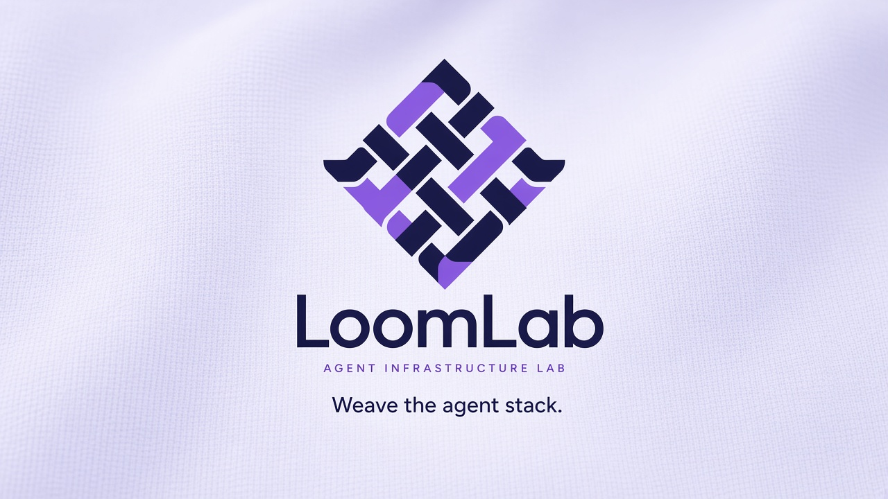

<!--
  LoomLab (loomlab-ai) organization profile README
  Lives at loomlab-ai/.github → profile/README.md
-->

  

<h1 align="center">LoomLab</h1>

<strong>Agent infrastructure lab</strong>

  Building the weave under coding agents: policy gates, safety skills, personal agent cores, and real-world agent towns.

## What we build

| Project | What it is |
| --- | --- |
| **[gate](https://github.com/loomlab-ai/gate)** | Sidecar policy intercept — allow / deny / ask + JSONL trace (Claude Code hooks first) |
| **[agent-safety-kit](https://github.com/loomlab-ai/agent-safety-kit)** | Agent Skills pack: permission-gate, git-guard, money-denylist, secret-scrub |
| **[github-launch-skill](https://github.com/loomlab-ai/github-launch-skill)** | Agent Skill that launches a project onto GitHub: bilingual README, About, license, Pages, CI, and SEO. |
| **[agent-mac-awake](https://github.com/loomlab-ai/agent-mac-awake)** | Keeps a Mac awake during long Cursor / Grok Bot runs (thin caffeinate wrapper + optional LaunchAgent). |
| **[milow-agent](https://github.com/loomlab-ai/milow-agent)** | Self-hosted, channel-agnostic personal AI agent core |
| **[agent-town](https://github.com/loomlab-ai/agent-town)** | Chinese Agent real-use-case library (agentmarket) |

## Principles

- **Runtime over slogans** — skills teach; Gate enforces.
- **One harness at a time** — earn the next IDE with real users.
- **Private by default** — open what is ready; keep the rest sealed.

## Links

- Org: [github.com/loomlab-ai](https://github.com/loomlab-ai)
- Display name: **LoomLab**
